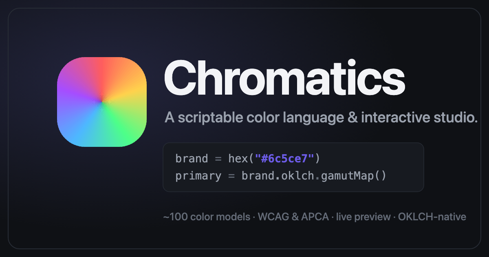

<div align="center">



# Chromatics

**A scriptable color language and an interactive studio for designing, analyzing and exploring color.**

Write a tiny program that derives a whole palette from one brand color, inspect any color across ~100 color models, check accessibility, and preview it on real UI — all in the browser.

[**🎨 Open the studio →**](https://lilbunnyrabbit.github.io/chromatics/) · [Color models](https://lilbunnyrabbit.github.io/chromatics/models) · [Mixer](https://lilbunnyrabbit.github.io/chromatics/mixer)

</div>

> Built with SvelteKit + Svelte 5, our own [`@lilbunnyrabbit/chromatics`](packages/chromatics) for color math, and CodeMirror for the editor.

---

## What's inside

### 🎨 The color DSL

A small, expression-oriented language for generating palettes. Every value is a model-agnostic color: construct it in any space, read any channel, and chain operations — the engine converts implicitly.

```text
// Dark mode — change the brand color, the rest follows.
brand = parse("#6c5ce7")

bg      = Oklch(0.17, brand.to(Oklch).c * 0.3, brand.to(Oklch).h)
surface = bg.clone().lighten(0.05)
fg      = Oklch(0.96, 0.012, brand.to(Oklch).h)
muted   = fg.clone().darken(0.32)

primary = brand.to(Srgb).gamutMap().to(Oklch)
accent  = brand.to(Oklch).rotateHue(150)

success = Hsl(155, 0.5, 0.55)
error   = parse("#e74c3c")
```

- **The DSL is the [`@lilbunnyrabbit/chromatics`](packages/chromatics) API**: every model is its class (`Oklch`, `Lab`, `Hsl`, `DisplayP3`, `Hct`, … 70 of them), callable with or without `new`, plus `parse("…")` for any CSS colour.
- **Convert** with `c.to(Lab)` (a new colour); read channels as properties (`c.to(Oklch).l`); set them with `c.l = 0.5`, `c.set({ … })` or `c.shift({ … })`.
- **Operations** are the model's own methods — `lighten` / `darken`, `rotateHue`, `mix`, `tint` / `shade` / `tone`, `gamutMap`, `contrast`, `deltaE2000`, harmonies, … They change the colour in place, as in JavaScript; `clone()` first to keep the original.
- **Old scripts** written for the pre-package DSL get an "Upgrade script" review that rewrites them and keeps their results.
- **Scheme output** — name your colors and they become a role-mapped scheme you can export or theme with.
- **Design surfaces as blocks** — `tokens { … }` (type/space/radius/shadow + custom token groups), `component { … }` (button/card/type specs), `preview { … }` (cards that render in the Inspector) and `roles { primary = brand, … }` (bind theme roles to your named colors). Inside a block you call the primitives bare — no repeated `preview.` / `component.` prefix; the dotted forms (`preview.x`, `theme({…})`, …) still work too.
- A CodeMirror editor with autocompletion, hover docs, inline diagnostics and shareable URLs.

### 🧪 The studio

A tabbed workspace around the editor:

- **Inspector** — a deep read-out of any color: its values across every model, plus analysis.
- **Studio** — build and refine the palette.
- **Matrix** — a contrast matrix of every foreground/background pair with WCAG levels.
- **Validate** — accessibility validation across the scheme.
- **Preview** — your palette on real typography and UI, driven by the DSL's `preview.*` primitives.
- **Explore** — the color tools (below).
- **Export** — copy the scheme out in multiple formats.

### 🌈 100 color models & systems

Every color is an instance of the package's class for the model it was built in, and any color converts to any other model.

- **`/models`** — an interactive encyclopedia of all 100 spaces (perceptual, RGB working/display, CIE tristimulus, video/broadcast, subtractive/print, color systems). Each entry has a live channel playground, a 2-D gamut plane, a pinned 3-D model viewer, cross-model read-outs, and relationship cross-links. 70 are implemented; the rest are documented as reference.
- **`/mixer`** — a cross-model mixer: one card per model, every channel a slider. Drag any slider to set a single color and watch every _other_ model re-read it live, with the model you're editing locked so it never jumps. Grouped by family with toggles.

### ♿ Accessibility & analysis

- **Contrast** — WCAG 2.x ratios + levels (AA/AAA, normal & large) and **APCA** (WCAG 3 draft).
- **Color-vision deficiency** simulation — protanopia, deuteranopia, tritanopia and more.
- **Color difference** — ΔE (CIE76, CIE94, CIEDE2000, CMC) and nearest-name lookup.
- **Print** — CMYK total-area-coverage / rich-black proofing.
- **Quantization** — extract a palette from an image.

### 🛠️ Tools

Harmony generation, gradients, tonal ramps, image color extraction, an eyedropper/picker, and an accessibility auto-fix.

### 📦 Exports

Hex / CSS, swatch SVG, Markdown tables, and round-trippable DSL source.

---

## As a library

The color math is its own package, [`@lilbunnyrabbit/chromatics`](packages/chromatics): every model as a typed class, conversions through a declared graph, cited sources for every number.

```js
import { Oklch, Srgb, Srgb8 } from "@lilbunnyrabbit/chromatics";

const c = new Oklch(0.57, 0.2, 283);
c.clone().lighten(0.1).to(Srgb).gamutMap().to(Srgb8).toHex(); // → "#…"
```

---

## Platform

- **SvelteKit** static SPA (adapter-static), **Svelte 5 runes** throughout.
- Responsive **desktop and mobile** shells; light / dark themes.
- State persists to the **URL hash** and `localStorage`, so any palette is shareable by link.

## Development

A Bun + Turborepo monorepo: the studio in `apps/studio`, the color package [`@lilbunnyrabbit/chromatics`](packages/chromatics) in `packages/chromatics`.

```sh
bun install
bun run dev        # start the studio
```

## Building & testing

```sh
bun run build      # every workspace (studio → apps/studio/build/)
bun run test       # studio (bun:test) + package (Vitest on node and bun)
bun run check      # svelte-check + tsc
bun run lint       # prettier --check
bun run format     # prettier --write
```

`turbo` caches each task; add `--filter=studio` or `--filter=@lilbunnyrabbit/chromatics` to run one workspace.

Deployed to **GitHub Pages** via GitHub Actions on every push to `master`.

## Routes

| Route     | What                                                           |
| --------- | -------------------------------------------------------------- |
| `/`       | The studio — editor, inspector, matrix, preview, tools, export |
| `/models` | Interactive encyclopedia of all 100 color models & systems     |
| `/mixer`  | Cross-model color mixer — one color, every model, live sliders |

---

## The vault — research, decisions & the color encyclopedia

`docs/chromatics/` is the project's **second brain**: an Obsidian vault that preserves every idea, decision and plan from the run that produced Chromatics (npm template → color engine → DSL → this unified app). It's the in-depth investigation this whole project grew out of — start at [`docs/chromatics/Home.md`](docs/chromatics/Home.md).

- **00 · Overview** — Vision, Project History, Status & Inventory, Glossary.
- **01 · Decisions** — ADR-style Decision Log, _Build vs Buy_ (why we wrap **culori**), Architecture Decisions, Open Questions.
- **02 · Knowledge** — color science & algorithms, accessibility (WCAG/APCA/CVD), color theory, the library landscape.
- **03 · DSL** — the canonical language spec + implementation notes.
- **04 · Product** — the Implementation Plan, the Unified Product Plan, feature specs and roadmap.
- **06 · Reference** — a ~113-note encyclopedia of color models & systems (the source behind `/models`).
